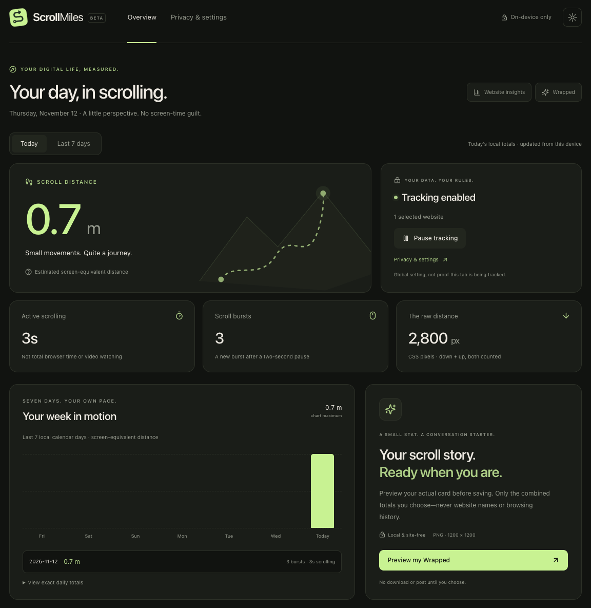
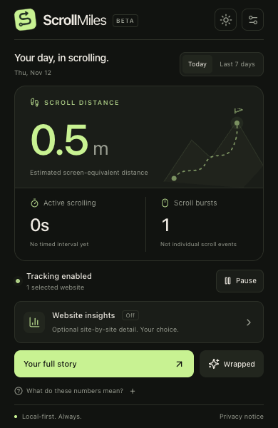
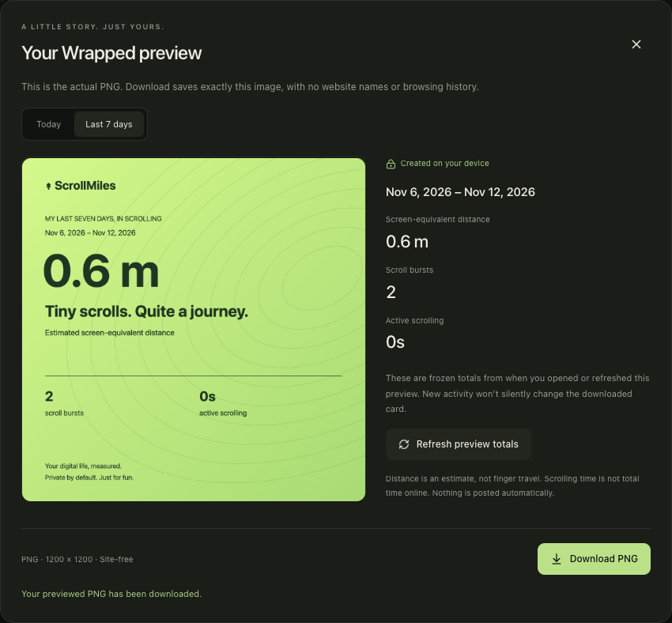
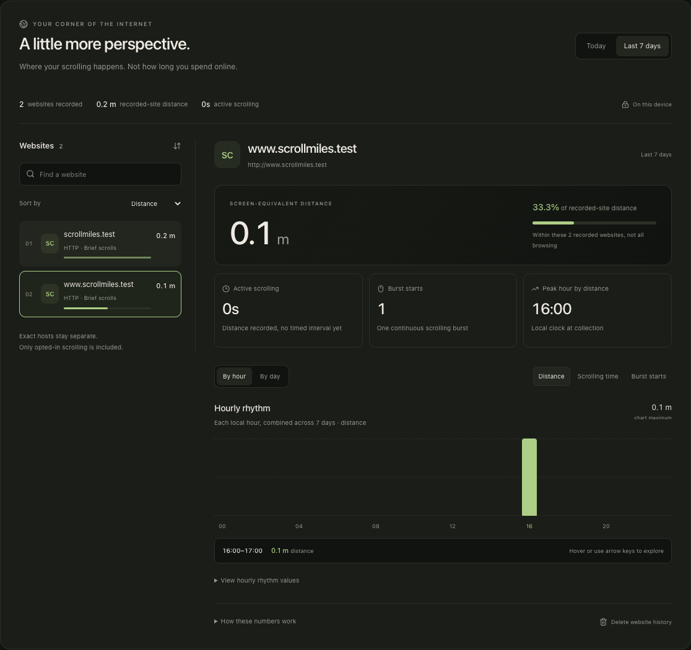

# ScrollMiles

**Your digital life, measured.**

A playful, privacy-first Chrome extension that turns everyday scrolling into a small personal journey. This is the first working beta, not the full product described in [the original context](ScrollMiles_Project_Context.md).

The [product strategy](docs/product_startegy.md) sets the next milestones: understand existing scrolling data first, add fun without pressure, and review browser-time/routine collection separately. Smart Insights 1.0 implements the current **Understand** slice—not the entire roadmap.

	<a href="#a-look-inside">Screenshots</a> ·
	<a href="#try-it-in-chrome">Try the beta</a> ·
	<a href="#optional-website-insights">Website insights</a> ·
	<a href="#development">Development</a>

## A look inside

> **Illustrative test activity—not personal browsing data.** These screenshots show the production extension using scripted scrolling on local test websites in disposable profiles. Each view is a separate test, so totals can differ. No sample activity is included in the shipped extension.

### Your scrolling story, at a glance

<picture>
	<source media="(prefers-color-scheme: dark)" srcset="docs/images/dashboard-dark.webp">
	<source media="(prefers-color-scheme: light)" srcset="docs/images/dashboard-light.webp">
	
</picture>

*Dashboard overview crop. The image follows your preferred light/dark theme; all distances are screen-equivalent estimates.*

<table>
	<thead>
		<tr>
			<th width="34%">A quick glance</th>
			<th width="66%">Preview before you share</th>
		</tr>
	</thead>
	<tbody>
		<tr>
			<td valign="top"></td>
			<td valign="top"></td>
		</tr>
		<tr>
			<td>Compact production popup document, captured in a bounded test tab—not Chrome’s physical toolbar window.</td>
			<td>The actual locally generated PNG. Totals stay frozen until you refresh; download saves the displayed image.</td>
		</tr>
	</tbody>
</table>

See the [opt-in website breakdown](#optional-website-insights) below. [Screenshot sources and refresh instructions](docs/images/README.md) explain the fixture data and image preparation.

## Try it in Chrome

The production extension has already been built locally.

1. Open Chrome and visit **chrome://extensions**.
2. Enable **Developer mode** at the top right.
3. Choose **Load unpacked** and select the **.output/chrome-mv3** directory inside this project. In the macOS picker, use **Cmd + Shift + G** and enter this project's absolute folder path followed by `/.output/chrome-mv3` if hidden folders aren't visible.
4. Pin ScrollMiles from Chrome's Extensions menu and open it.
5. Enter a website's exact hostname, such as **en.wikipedia.org**, and select **+**. Accept Chrome's website-access prompt.
6. Open that website in a normal tab and scroll. Totals update within a few seconds. If an already-open page does not start collecting, reload it once.
7. Select **Your full story** for the dashboard. Open **Preview my Wrapped**, inspect the actual image, then choose **Download PNG**. Open **Privacy & settings** to manage access.

Nothing is tracked until a website is enabled. HTTPS and HTTP are separate; so are subdomains. For example, enabling `https://example.com` does not enable `https://www.example.com`. Chrome host permissions cover all paths and ports for a hostname. Paste a URL if convenient; paths, credentials, query strings, and fragments are not saved (credential-bearing URLs are rejected).

### Popup — a quick glance

The toolbar popup is a focused summary, not a squeezed dashboard. **Today / Last 7 days** selects the existing local aggregate and the initial period used by **Wrapped** preview. The large distance is clearly a screen-equivalent estimate. **Active scrolling** and **Scroll bursts** are not browser-use time or session counts; zero timed seconds can accompany an isolated scroll, and sub-second durations show **<1s**. Expand **What do these numbers mean?** for the raw CSS-pixel total and measurement definitions.

The status row separates **tracking enabled**, **tracking paused**, **no website access**, and **status unavailable**. It describes the global collection setting, not proof the current tab is being tracked. Selected-host coverage or all-site/exclusion counts stay visible. Pause/resume is one click and does not erase history. A failed refresh warns that the previous numbers may be stale and disables the popup's pause/export actions until a successful read.

First use prioritizes the website access form instead of empty metric tiles; optional all-site access is reviewed in settings. Once access is configured, detailed permission management moves to **Privacy & settings**, always reachable from the header. **Website insights** links directly to the real dashboard section only when separately opted in; when off it links to settings without enabling anything. **Your full story** opens the full dashboard. Navigation links open extension pages in a new tab; Wrapped first opens the actual local, site-free PNG preview, without starting a download.

The first-use and populated baseline layouts are tested to fit a 390px-wide/600px-high surface, with no horizontal overflow at 320px. Expanded explanations, very large values, long warnings, and some empty states can require vertical scrolling. Real collection, storage, permissions, and consent rules are unchanged. Physical toolbar behavior and native permission prompts remain manual acceptance checks; browser tests render the actual production popup document in bounded tabs.

### Dashboard — your scrolling story

The overview uses the same warm dark/lime/light palette as the popup and insights. It separates the distance estimate, collection status/coverage, active scrolling, bursts, and raw CSS pixels. **Today / Last 7 days** changes the summary; **Your week in motion** always shows the last seven local calendar days. Hover, focus, or select a daily bar for its readout, or expand **View exact daily totals** for the table. Genuine zero days stay zero.

The collection card offers global pause/resume when website access is configured. Its status describes the collection setting, not proof the current tab is tracked. First use keeps exact-host setup available; ongoing access/exclusion management lives in settings. Section links lead to Website insights and Wrapped without changing consent. Measurement explanations are available in a collapsed disclosure, not mixed into every chart.

### Smart Insights — observations, not guesses

Open **Smart insights** from the dashboard section links. Deterministic calculations use existing local aggregates; there are no AI calls, new permissions, new tracking fields or database migration.

- **Recorded scrolls:** daily or rolling-seven-day distance, burst totals and active scrolling, synchronized with the overview period. The current day is explicitly partial.
- **Most distance recorded:** an actual date in the selected window, with all ties reported—not a claim about a typical weekday or a lifetime record. Empty data produces no inferred pattern.
- **Peak recorded hour:** the hour with the most **recorded-site distance**, only when Website insights is already enabled. In the seven-day view, each hour is summed across those dates. Ties are explicit; anonymous daily totals cannot reveal hours.
- **Two complete weeks:** the last seven complete local dates versus the seven before them, excluding today from both windows. The worker reads only those 14 days of already-retained anonymous totals; the normal overview still reads seven. Both date ranges, totals and saved-day counts are shown. Changes are calculated only when every comparison date has a saved aggregate. Missing rows can mean inactivity, pauses or no collection, so they are not treated as verified zeros. A zero previous total has no percentage. Even saved rows do not prove continuous collection; changes are recorded differences, not improvements or attention scores.
- **Your scrolling rhythm:** a seven-date × 24-hour heatmap of existing opted-in details. Switch distance, burst starts or active scrolling; use arrows, Home/End and Ctrl+Home/End, or expand the exact table. The heatmap always shows seven dates even when the summary is Today. Empty cells mean no recorded detail, **not confirmed inactivity**. On narrow screens the grid scrolls sideways while date labels remain visible. Original local hour labels are retained, repeated DST hours merge, and timezone changes do not regroup old rows.

Enabling Website insights remains a separate settings confirmation; opening Smart insights never enables it. There is no hourly backfill. Opt-out/per-site deletion removes the corresponding heatmap detail while keeping anonymous totals; global deletion clears both. Failed loads suppress fresh observations, and an older worker without comparison history gives reload guidance rather than fake zeros.

The [measurement and acceptance notes](docs/SMART_INSIGHTS.md) explain the deliberately conservative baseline rule. Longest individual burst, achievements, personality types and browser-active/session timing are **not** added by this milestone; daily/hourly aggregates cannot recover an individual burst maximum. No retention period or Wrapped contents are changed.

### History — daily records and monthly summaries

Open **History** in the dashboard section links. This reads up to **90 existing anonymous daily aggregates**, without new collection, permissions or a database migration. The worker anchors the inclusive retention dates; popup/settings do not request the larger history response. An older worker shows reload guidance, not a made-up empty history.

**Personal records within retained history** show the largest positive daily distance, daily burst count and daily active-scrolling total among past saved dates. Today is excluded while still in progress. All tied dates are available, and no positive data means no record. These are observed maxima, not targets, achievements or all-time records. They can change as late checkpoints arrive or older dates expire; an active-scrolling daily total is not an individual burst length.

**Monthly summary** offers each calendar month intersecting retention, independently of Today/Last 7 days. Distance, bursts and active scrolling are recorded subtotals—not claims of complete monthly activity. The current month includes explicitly labeled partial today; future dates are excluded. The oldest month can be cut off by retention, with its earlier dates labeled outside the retained window. Dates with no saved record are unknown, not verified zeros. Saved zeros, missing records, expired dates and future dates have separate text states in the interactive calendar/readout and exact table. Saved-day counts are not collection-coverage percentages.

Use the month selector, click a date or explore with arrows/Home/End/Ctrl+Home/End. The calendar starts Sunday and stays usable at narrow widths. No averages, month-over-month changes, streaks or pressure to scroll are inferred. Summary totals can include today, while daily record rankings do not. Global Delete history clears the source data; website-detail opt-out/deletion preserves these anonymous totals. Retention stays at 90 days—there is no hidden permanent record store. See [history measurement notes](docs/HISTORY.md).

### Wrapped — preview, then download

Both popup and dashboard open a modal containing the **actual 1200 × 1200 PNG**, not a separate HTML approximation. Choose Today or Last 7 days and inspect the date/range and combined distance, bursts, and active scrolling. Opening the preview does not save or post anything; **Download PNG** saves the exact rendered image you see.

Totals are captured when the preview opens. New scrolling or the dashboard's live refresh does not silently change the card; **Refresh preview totals** deliberately takes a new snapshot. Deletion or a tracking-policy epoch change invalidates the open preview. A failed statistics refresh disables downloading until a successful read; a drawing failure offers **Retry preview**. Zero-data cards contain honest zeros. Escape or Close dismisses the modal and returns focus to its trigger, and Tab stays within its controls.

Only anonymous combined totals and the selected dates reach the renderer—never site identifiers or URLs. The image is generated locally, temporary image URLs are released when replaced/closed, and nothing is uploaded. An already-downloaded PNG remains outside extension storage and is not removed by deleting history. A physical toolbar popup can close when Chrome dismisses it; reopen the preview or use the dashboard if needed.

### One permission for all supported websites

Open **Privacy & settings → All supported websites → Set up all-site access**. Read the sensitive-site warning, then choose **Allow all supported websites** and accept Chrome's prompt. This is **off by default** for both new and existing installations. No mandatory install-time website access has been added.

This explicitly enables HTTP/HTTPS websites and subdomains in normal browsing. Only scrolling in the visible, focused page is collected; watching a video alone is not measured. Chrome-protected pages and incognito remain excluded. All-site mode includes sensitive websites unless you exclude them, so use selected-site mode when you want the narrowest access.

In all-site mode, the website form adds **exclusions**, not grants. Exclusions are exact scheme/hostname controls inside ScrollMiles; they do not revoke Chrome's broad host permission. Exclude both `https://example.com` and `https://www.example.com` separately when needed. Pausing still stops collection everywhere.

**Turn off all-site access** revokes wildcard and covered website permissions and returns to selected-site mode with **no websites enabled**. Earlier totals and exclusions remain. Enable individual websites again afterwards. External partial broad-permission revocation also fails closed to no enabled sites rather than silently keeping broad mode active.

For YouTube in selected-site mode, enable **https://www.youtube.com** if that is the hostname of the video page. The full page path, video identifier, and comment position do not affect permission matching. Root scrolling and ordinary nested comments count; embedded frames and custom/shadow scrollers are not guaranteed. Live YouTube compatibility still needs a real-site check—local fixtures do not prove every YouTube layout works.

### After rebuilding: reload the extension

Rebuilding files does not replace Chrome's currently running background worker. If a new control reports **Unknown request** or asks you to reload, open **chrome://extensions**, click **Reload** on ScrollMiles, close any old ScrollMiles dashboard/settings tabs, and reopen it from the toolbar. Reloading preserves extension-managed settings and history; **do not remove and reinstall** as a troubleshooting shortcut. Reload the website tab if its collector still belongs to the old extension context.

The settings page checks the worker's advertised all-site support before offering a new broad-permission request. An older worker without that capability produces explicit reload instructions, not a permission request it cannot process. No automatic reload or permission grant is performed.

### Optional website insights

Open **Privacy & settings → Website insights → Set up website insights**. The confirmation explains that exact scheme/hostnames will be stored with local hourly scrolling totals for up to 90 days. Choose **Enable website insights** only if you want that extra detail. It is **off by default**, including on existing installs, and requires no new Chrome permission.

<picture>
	<source media="(prefers-color-scheme: dark)" srcset="docs/images/site-insights-dark.webp">
	<source media="(prefers-color-scheme: light)" srcset="docs/images/site-insights-light.webp">
	
</picture>

*Illustrative local-fixture activity after explicit insights opt-in. The hostnames are test sites; the share is of recorded-site scrolling distance, not browser time.*

The dashboard adds a **Website insights** panel headed **A little more perspective**. Search exact recorded hosts or sort by distance, scrolling time, or burst starts. Select a site for its distance, active scrolling time, burst starts, and peak local hour. Its distance share is relative to **recorded-site distance**, never all browser activity or old anonymous history. Search does not change that denominator. Monogram icons are generated locally—no external favicons or guessed site branding.

Use **By hour / By day** and **Distance / Scrolling time / Burst starts** to explore the chart. Hover over a bar or focus the chart and use Left/Right/Home/End for its exact readout; all pixel/time/burst values remain available in an expandable table. Today and Last 7 days controls in the panel stay synchronized with the overview. **By day always shows seven days**; hours combine across seven days when that period is selected. Zero timed seconds is explained: an isolated scroll event can record movement without a measurable event-to-event interval. Positive durations shorter than a second display **<1s**. No example activity is inserted into production.

Only scrolling after opt-in is attributed; old anonymous totals cannot be split retrospectively. Site totals may therefore be lower than global totals. Exact schemes and subdomains remain separate. A local hour combines repeated DST hours; timezone travel does not retroactively regroup records. A continuous burst is counted where it starts; its event-to-event active time is split at hour/day boundaries. Clock/timezone discontinuities break the burst instead of inventing duration.

**This is scrolling time, not time spent on a website.** Watching a YouTube video without scrolling adds no distance or active scrolling time. Session duration, attention scores, direction-change analytics, and browser-active time are not implemented.

**Turn off & delete website insights** erases all detailed site/hour history but keeps anonymous totals. **Delete website history** erases all retained details for one site, also without subtracting combined totals. New scrolling can be recorded again while opted in. Permission removal/exclusion stops future collection but does not delete existing details; use the deletion controls separately. Global Delete history clears both stores and pauses, retaining settings/preferences. Epoch changes and durable deletion intent prevent stale messages or worker interruption from silently restoring deleted details. Wrapped stays hostname-free.

Reload the extension and close old dashboard/settings tabs after updating. Reload already-open website tabs if they still contain an older daily-only collector. IndexedDB upgrades from v1 to v2 without removing anonymous history; no website is inferred for old data.

### VS Code integrated-browser preview

The static production pages can be served locally for UI inspection inside VS Code. This is **not the installed extension**: the integrated browser does not provide ScrollMiles' Chrome extension storage, host permissions, background worker, or collector. Dashboard/settings correctly report unavailable statistics rather than inventing activity. The privacy notice remains readable without extension APIs.

Use the real Chromium integration suite for permission, aggregation, pause, deletion, and lifecycle checks. UI preview does not exercise your installed Chrome extension or diagnose its currently loaded worker version.

## What works

- Vertical scrolling distance in CSS pixels, counting both directions.
- Scroll bursts and estimated active scrolling duration.
- Today's totals and a rolling seven-local-calendar-day summary.
- Local Smart Insights: honest daily/seven-day observations, completed-period comparisons when enough saved history exists, and a consent-gated day/hour heatmap with exact values.
- Personal daily records within retained history and calendar-month summaries with honest missing/expired/future states and exact daily values.
- Real zero-state UI: no fabricated data or invented improvement percentages.
- Dark-first popup, full-page dashboard, light theme, and privacy settings.
- Branded Chrome toolbar icons and an offline, bundled privacy notice.
- Explicit loading failures, stale-data warnings, and retry controls instead of misleading zero totals.
- Actual local 1200 × 1200 PNG Wrapped previews, explicit download of the displayed image, and no website identifiers.
- Per-host opt-in, immediate global pause, permission removal, and delete-history controls.
- Optional all-supported-websites opt-in with a separate confirmation, broad-permission revocation, and exact-host exclusions.
- Separate opt-in website/hour scrolling aggregates, per-site active scrolling and burst starts, hourly breakdowns, seven-day trends, and detailed-history deletion.
- IndexedDB history with atomic, retry-safe checkpoints and 90-day retention.
- No account, backend, cloud synchronization, third-party analytics, or production network requests.

Not implemented: website usage duration, session analytics, morning/night insights, achievements, notifications, mobile tracking, physical-activity integrations, or Web Store publishing. The first beta deliberately validates scrolling and sharing before expanding scope.

The separate [browser-active time and sessions proposal](docs/BROWSER_TIME_DESIGN.md) defines a possible later slice, consent, session boundaries, uncertainty, and acceptance tests. It is **design only**: no timing collection, session statistics, new opt-in, or `idle` permission has been added. Those decisions need review before implementation; old scrolling history cannot supply them.

## Measurement definitions

**Distance** is cumulative absolute vertical scroll displacement. Down 1,000 CSS px and up 500 CSS px produces **1,500 CSS px**. Nested containers are measured separately; embedded iframe content is not tracked.

**Displayed metres/kilometres** are screen-equivalent estimates using 96 CSS px per inch: approximately **3,779.53 CSS px per metre**. They are not calibrated monitor distance, physical finger travel, exercise, or literal miles. Browser zoom does not turn CSS pixels into physical measurements. Raw CSS pixels remain visible in the dashboard and accessible daily table.

**A burst** is a sequence of nonzero scroll events separated by less than two seconds. A gap of two seconds or more starts another burst. Separate gestures within that interval are one burst.

**Active scrolling time** sums gaps between events in the same burst. Idle gaps and the tail after the last event are excluded. This intentionally avoids the original context document's proposed `min(gap, 2000)` formula, which would add two seconds after a long inactive gap. A single isolated scroll event contributes distance and a burst, but zero duration.

Collection requires an enabled website, a visible document, and document focus. Switching tabs or leaving the browser stops measurement and breaks the burst. The extension does not measure total browser usage or psychological attention span; idle permissions are unnecessary for this limited slice.

## Reliability and known limits

- Checkpoints contain **cumulative counters**, a random stream ID, sequence, and data epoch. History and deduplication commit in one IndexedDB transaction. Retries or service-worker restarts do not double count accepted data.
- Settings and policy changes are serialized by the service worker. Deletion changes the epoch before removing history; stale messages cannot restore deleted totals even after tracking resumes.
- Collection flushes at most once per second while scrolling, with three bounded exponential-backoff retries and best-effort flush on blur, hide, or navigation. **An abrupt tab close, browser crash, or extension update can lose the last unacknowledged second, or more during storage errors.** This is not a lossless audit log.
- Policy changes reset collector buffers. Pause, site changes, and deletion prioritize stopping collection over preserving the last unsent batch.
- Per-document daily buffers and deduplication retention are bounded to 90 calendar days. Clock rollback/timezone changes may temporarily defer future-labeled checkpoints. Existing totals retain the local calendar date used at collection; history is not retroactively moved to a new timezone. DST/timezone travel need broader manual validation.
- Existing checkpoints for previous days are safe to resend. Once a record ages beyond retention it is dropped; no unbounded message queue or continuous service-worker timer is used.
- Automatic/programmatic scrolling, scroll anchoring, and some layout changes may count as movement. Distinguishing physical user input reliably is not claimed.
- Standard root scrolling and nested panels are supported. A nested panel first observed after movement starts may miss its initial delta; pointer/wheel/touch interactions prime its geometry without reading content. Custom canvas feeds, shadow-root scrollers, virtualized panels, PDFs, and browser-protected pages need manual compatibility testing or may be unsupported.
- Chrome's Web Store and browser-internal pages cannot be tracked. Incognito use is prohibited in the manifest, not just switched off in the UI.
- Removing a website stops future collection and revokes its host permission. Existing anonymous totals remain; optional site details remain until their dedicated deletion control or global deletion is used.
- Delete history removes statistics and checkpoints and pauses collection. It preserves website choices, exclusions, all-site preference/permissions, and theme. Remove websites or turn off all-site access separately to revoke access, or uninstall to remove all extension data. A PNG already downloaded is outside extension storage and must be deleted separately.
- Default history remains anonymous combined totals. If Website insights is enabled, a separate local store contains exact scheme/hostname with date/hour scrolling aggregates—not URLs, page visits, or browsing sessions. Random document/bucket IDs and cumulative checkpoint counters contain no hostnames, page titles, paths, or content. Settings also retain the separate insights choice/start time.

## Development

Requires **Node.js 22.12+** and **npm 11.21.2+**. The verified package-manager release is declared in [package.json](package.json) and pinned in CI. Older npm releases can incorrectly reject optional native/WASM dependencies during a cross-platform clean install. Dependencies are locked in [package-lock.json](package-lock.json).

| npm script | Purpose |
| --- | --- |
| `npm install` | Install dependencies and generate WXT types |
| `npm run dev` | WXT development mode |
| `npm run assets` | Regenerate local 16/32/48/128 px PNG icons from the bundled SVG |
| `npm run build` | Create the Chrome MV3 production extension |
| `npm run typecheck` | Strict TypeScript validation |
| `npm test` | Vitest measurement, storage, analytics, authorization, privacy, and lifecycle tests |
| `npm run test:e2e` | Run Chromium integration tests against the production build |
| `npm run zip` | Package the production extension |

Before integration tests, run the production build and install Playwright's browser with `npx playwright install chromium` (already installed in the current environment). Tests use a temporary browser profile and a local-only HTTP fixture. Chromium's native permission bubble is not a page DOM element: the tests pre-approve the fixture host through **chrome://extensions**, then exercise the real UI and `chrome.permissions.request`. No extension API is mocked in browser tests. Separate component tests simulate denied, blocked, and throwing permission APIs; native permission-prompt acceptance/denial still needs a manual check.

The browser suite also verifies a genuine service-worker stop/wake, packaged icon dimensions, offline privacy navigation, optional all-site mode/exclusions/revocation, exact-host boundaries, local infinite-feed/SPA fixtures, wheel and keyboard inputs, two actual browser windows, navigation, deletion cancellation, export persistence, real 200% browser zoom, and recovery from an incompatible database in a disposable profile. Wrapped checks compare the downloaded bytes with the displayed PNG, freeze the card during new real scrolling, refresh explicitly, and invalidate previews after cross-tab deletion. A test-only observer captures Blob bytes while delegating the original object-URL creation; it does not mock extension APIs, the renderer, or measured activity. Fixtures map test domains to loopback, and off-fixture page/worker HTTP attempts are logged, blocked, and fail the suite. A real bug on ordinary non-localhost HTTP pages was fixed: collector IDs use the UUID library's cryptographic fallback where `crypto.randomUUID()` is unavailable.

Collector tests simulate midnight before flush, wall-clock rollback, bounded retries/recovery, idle behavior, and immediate epoch/exclusion changes. Calendar tests run the actual metrics module in isolated processes with New York DST and multiple timezones; they do not change the Mac's clock. These checks complement—not replace—the remaining manual checks in [the beta checklist](docs/BETA_CHECKLIST.md). See the [dated beta results](docs/BETA_RESULTS.md) for what was and was not verified. Raw screenshots remain in ignored local test output; only the [reviewed documentation images](docs/images/README.md) are committed for the README.

Development mode may need a supported local Chrome installation and WXT's development runner. WXT adds localhost tooling in dev mode. Production has a restrictive `connect-src 'none'` policy and no mandatory host permissions. Always inspect the production manifest before distribution.

## Project map

| Location | Responsibility |
| --- | --- |
| [entrypoints/background.ts](entrypoints/background.ts) | Authorization, optional host registration, policy changes, serialized aggregation |
| [entrypoints/content.ts](entrypoints/content.ts) | Geometry-only scrolling, focus gating, batching, bounded retries |
| [src/tracking/ScrollTracker.ts](src/tracking/ScrollTracker.ts) | Pure scroll/burst/duration algorithm |
| [src/storage/database.ts](src/storage/database.ts) | Versioned IndexedDB schema, atomic checkpoints, retention |
| [src/storage/settings.ts](src/storage/settings.ts) | Local settings and policy epoch |
| [src/analytics/metrics.ts](src/analytics/metrics.ts) | Local calendar grouping and display formatting |
| [src/analytics/sites.ts](src/analytics/sites.ts) | Pure per-site ranking, hour summaries, and seven-day reporting |
| [src/analytics/insights.ts](src/analytics/insights.ts) | Deterministic summaries, completed-period comparisons and site-free hourly view models |
| [src/analytics/history.ts](src/analytics/history.ts) | Retained-window daily records and calendar-month models without inferred coverage |
| [src/tracking/HourlyScrollTracker.ts](src/tracking/HourlyScrollTracker.ts) | Continuous-burst attribution across hour/day boundaries |
| [src/components/SiteInsights.tsx](src/components/SiteInsights.tsx) | Explicit detailed-history consent, live site analysis, accessible charts, and deletion |
| [src/components/App.tsx](src/components/App.tsx) | Shared popup/dashboard/settings UI |
| [src/components/PopupOverview.tsx](src/components/PopupOverview.tsx) | Compact real-data popup, coverage/pause status, onboarding and navigation |
| [src/components/DashboardOverview.tsx](src/components/DashboardOverview.tsx) | Dashboard hierarchy, collection coverage, seven-day chart and preview entry |
| [src/components/SmartInsights.tsx](src/components/SmartInsights.tsx) | Honest insight cards, recorded-history comparisons and accessible opt-in heatmap |
| [src/components/HistoryOverview.tsx](src/components/HistoryOverview.tsx) | Retained-history records, monthly summary/calendar and exact-value table |
| [src/components/WrappedPreview.tsx](src/components/WrappedPreview.tsx) | Actual-image modal, explicit refresh/download, focus and temporary-image lifecycle |
| [src/components/PrivacyPage.tsx](src/components/PrivacyPage.tsx) | Offline privacy notice, independent of historical database/worker availability |
| [src/privacy/policy.ts](src/privacy/policy.ts) | Single source of privacy notice text; publisher/contact review required before public release |
| [assets/brand/icon.svg](assets/brand/icon.svg) | Original brand icon source, rasterized locally during build |
| [src/wrapped/model.ts](src/wrapped/model.ts) | Frozen anonymous period totals, dates and export filenames |
| [src/wrapped/CardRenderer.ts](src/wrapped/CardRenderer.ts) | Local Canvas PNG generation and download of the rendered preview |
| [tests](tests) | Unit, authorization, storage and real-browser checks |

WXT + React + strict TypeScript + Tailwind CSS. `idb` is the small typed wrapper around IndexedDB; `uuid` creates random collector IDs on HTTP as well as HTTPS. Lucide supplies bundled SVG icons. The seven-bar chart is accessible HTML/CSS with a data table, so a charting library is unnecessary at this stage. Vitest and Playwright are development-only dependencies. No empty future modules, application server, or unnecessary infrastructure.

## Before a public beta

- Test real infinite feeds, nested panels, browser sleep/wake, zoom, DST, timezone travel, rapid navigation, and multiple windows.
- Exercise native permission acceptance and denial manually.
- Icons and an in-app privacy notice are included. Before distribution, approve publisher/contact details, a public privacy-policy URL, store screenshots, and accurate Chrome Web Store data disclosures.
- Review extension accessibility and performance on low-powered devices.
- Decide distribution/license terms. This source repository is public, but no open-source license has been selected. Public source visibility is not a Chrome Web Store release or approval to publish the extension.
- If using employer-provided Copilot Business, confirm organizational policy permits personal-project development.

See [the beta checklist](docs/BETA_CHECKLIST.md) for automated coverage, native-permission checks, the compatibility matrix, and public-distribution blockers. This work does not publish or submit the extension.